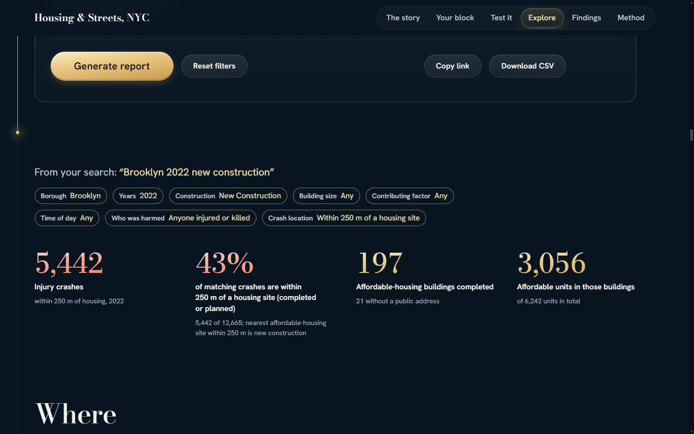
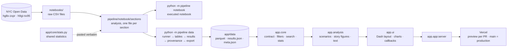

<div align="center">

# NYC Affordable Housing & Street Safety Analytics

**Do injury crashes rise around city-financed affordable housing once it opens?**<br>
An end-to-end data engineering project that joins two NYC Open Data tables with no shared key,<br>
answers ten research questions with honest uncertainty, and publishes the results as an interactive website.

[](https://github.com/AhmedAtefYoussef/NYC-Affordable-Housing-Street-Safety-Analytics/actions/workflows/tests.yml)


[](LICENSE)

### [Open the live site →](https://data-engineering-visualization-proj-three.vercel.app/)


</div>

---

## At a glance

| | |
|---|---|
| **Data** | 9,551 affordable-housing buildings (7,593 located) and 1,504,722 police crash reports, 2016 to 2025 |
| **Integration** | ZIP code × year panel, plus a haversine ball-tree spatial join (every crash within 250 m of a building) |
| **Analysis** | 10 research questions; event study and difference-in-differences with cluster-bootstrap intervals; 15 robustness variants |
| **Product** | Executed Jupyter notebook + a one-page Dash website with search, filters, a Generate report button, maps and a live re-estimation lab |
| **Engineering** | Layered packages, a schema-contracted atomic data build, provenance hashes, 885 tests at 98% coverage, CI and preview deployments |

## Key findings

- **Before anything was built, the sites already stood on more dangerous streets.** New-construction sites sat **19.1 percentile points** above their borough's median street (95% interval 9.4 to 22.3). This is the clearest result in the analysis.
- **After completion, the change cannot be told from no change.** Among the 128 new-construction buildings that could be compared fairly, injury crashes within 250 m changed by **−4.6%** relative to sites not yet completed (95% interval −11.9% to +3.3%).
- **The before-and-after estimate depends on how comparison sites are chosen.** Three of 15 robustness variants have an interval that excludes zero, two below and one above.

All results are associations, not causal effects: buildings are not placed at random, and only part of the programme could be isolated.

<p align="center"></p>

## What this project demonstrates

| Skill | Where it shows |
|---|---|
| **Data acquisition at scale** | Paged Socrata API download on `collision_id` with retries, back-off and resume after interruption (notebook Section 2) |
| **Cleaning with an audit trail** | 49 cleaning rules, each logged with the rows it touched and shipped to the site as `cleaning_log` |
| **Joining datasets with no key** | ZIP × year aggregation and a ball-tree distance join, validated against brute force; ZIP recovery tested on a holdout |
| **Statistical rigour** | Cluster bootstrap, event study, difference-in-differences, Benjamini–Hochberg correction, placebo and robustness checks |
| **Pipeline design** | `python -m pipeline` CLI; the build is split by stage, writes atomically, verifies its own output with the website's code, and records hashes and versions |
| **Single source of truth** | The statistics live in one file (`app/core/stats.py`), imported by the site and pasted verbatim into the notebook |
| **Software architecture** | `core ← analysis ← ui` layers, enforced by a test that parses every import |
| **Testing** | 885 tests, including recomputing every number the site shows from the raw files with independent code |
| **Production operations** | Serverless deployment under a 500 MB budget; a real outage diagnosed from runtime logs and fixed by pinning dependencies |
| **Front end and accessibility** | Lazy chart loading (first paint 18 s → 3.5 s on a throttled phone), no axe-core WCAG 2.2 A/AA violations |

## Architecture



Four guards keep the pieces consistent:

1. **Contract.** The build writes each table's schema into `meta.json`, and the site refuses to start on data that does not match it.
2. **Self-check.** Before replacing `app/data/`, the build reloads the new files with the website's own code and requires it to reproduce the notebook's headline estimates and intervals.
3. **Provenance.** `meta.json` hashes the raw files and the analysis sources; a test fails when either changes without a rebuild.
4. **Layering.** `tests/test_architecture.py` fails on any import that points to a later layer, and keeps Dash and Plotly out of `core` and `analysis`.

Details: [docs/ARCHITECTURE.md](docs/ARCHITECTURE.md). How to add a filter, table, chart, page section or research question: [docs/EXTENDING.md](docs/EXTENDING.md).

## Repository layout

```
app/                          the Dash website (reads only app/data/)
  app.py                      entry point: app.app:server on Vercel, python -m app.app locally
  core/                       data contract, filter model, search parser, shared statistics
  analysis/                   numbers and sentences for the page (no web framework)
  ui/                         theme, charts, report, callbacks, map-grid route, page sections/
  assets/                     css/ and js/
  data/                       pre-aggregated tables written by the pipeline (about 3.3 MB)
pipeline/                     raw data → notebook and website data
  __main__.py                 python -m pipeline notebook | data
  paths.py                    every location, defined once
  notebook/                   assemble.py and sections/ (00_title … 10_story, about 5,300 lines)
  build/                      checks, runner, frames, tables, results, provenance, export
notebooks/                    NYC_Housing_Safety.ipynb (executed, 222 cells) and the two raw files
tests/                        15 test files, 885 tests
docs/                         architecture, extending, methodology, data dictionary, number changes, AI use
.github/workflows/tests.yml   CI: ruff, the test suite and a 97% coverage floor
```

## Getting started

Requires Python 3.12 or newer.

```bash
python -m venv .venv
source .venv/bin/activate          # Windows: .venv\Scripts\activate
pip install -r requirements-dev.txt
```

Run the website (open http://127.0.0.1:8050, or set `PORT`):

```bash
python -m app.app
```

The site reads only `app/data/`, which is committed, so it runs straight after cloning. Map tiles load from CARTO, so the map needs an internet connection.

### The pipeline

```bash
python -m pipeline notebook --execute     # rebuild and run notebooks/NYC_Housing_Safety.ipynb
python -m pipeline data                   # rebuild app/data/ (about a minute, about 3 GB of memory)
python -m pipeline notebook --sections 01 02 04 --execute --out dev.ipynb   # partial run while editing
```

The notebook can also be opened and run directly: it reads the two data files from its own folder, downloads them from NYC Open Data if they are missing, and imports nothing from the repository. A failing cell never overwrites the notebook, and a failing check never replaces `app/data/`.

## Testing and quality

```bash
ruff check app tests pipeline
python -m pytest -q tests --cov=app
```

| Suite | What it proves |
|---|---|
| Data accuracy | Every exported table and every number the site shows, recomputed from the raw files with separate code, including 49 filter combinations (40 drawn at random with a fixed seed) |
| Pipeline contract | A missing, renamed or retyped column stops the site at start-up; exports are atomic; provenance follows content |
| Statistics | The bootstrap and difference-in-differences code against hand-computed cases |
| Architecture | The layer order and the pipeline's dependency on `app.core` only |
| Site behaviour | Callbacks through Flask's test client, the search parser, scenarios, block records, security headers and hostile inputs |

CI runs all of it on every push and pull request. The data-accuracy tests skip themselves when the raw files are absent.

## Deployment

The site runs on **Vercel** as one Python function (`app.app:server`, set in `pyproject.toml`; 60-second limit in `vercel.json`). Every pull request gets a preview deployment and `main` deploys to production. `.vercelignore` leaves the notebook, pipeline, tests and docs out of the bundle.

A Python function on Vercel may hold at most 500 MB of installed packages; above that, packages are reinstalled on each cold start into a small disk and the page fails. An unpinned dependency once caused exactly that outage. It was diagnosed from the runtime logs, reproduced locally and fixed by pinning every package. The site therefore reads its data with fastparquet (about 17 MB) instead of pyarrow (about 170 MB). The installed size is now about 410 MB, and a cold start loads the data in about a second using about 300 MB of memory.

## Team and contributions

ICS 503 Data Engineering and Visualization, German International University, Winter 2026. Each member proposed two research questions and owns their charts.

| Member | Research questions and charts | Data cleaning | Integration | Website | Other work |
|---|---|---|---|---|---|
| **Ahmed Atef** (M1) | RQ1 forecast comparison (dot plot of forecast error); RQ2 within-ZIP slopes (coefficient plot with leads and lags) | Housing: blank unit counts, duplicates, geographic identifiers, dates, unit consistency, size outliers (4.1–4.6) | ZIP by year panel (5.2) | Dropdown filters and the Generate report button | Setup and data loading (1, 2), housing exploration (3.3), README run steps |
| **Nour Mostafa Aly** (M2) | RQ3 event study (lines with interval bands); RQ4 building size (scatter with fitted slope) | Crashes: key, duplicates, dates, time of day, borough and ZIP (4.7, 4.8) | Ball-tree distance join, choice of the 250 m buffer (5.3) | Event-study cards and the bootstrap callback | Crash exploration (3.4), bootstrap and difference-in-differences toolkit (7) |
| **Yahia Mohamed** (M3) | RQ5 new construction vs preservation (interval plot); RQ6 pedestrian and cyclist share by borough (interval plot) | Crashes: coordinates, casualty totals, extreme injury counts, factor groups (4.8–4.11) | Sites, clusters and the nearby-completion screen (5.4) | Search box and query parser | Robustness checks (9), data dictionary |
| **Moaz Ahmed** (M4) | RQ7 site selection (percentile histogram); RQ8 hour of day (interval plot of day parts) | ZIP recovery from coordinates and its holdout validation (6.1) | Tagging crashes with their nearest site (5.5), conservation checks (6.4) | Map and heat-map cards, page layout, accessibility | Deployment configuration, architecture notes |
| **Yassin Fady** (M5) | RQ9 deep-affordable share across ZIP codes (scatter by borough); RQ10 contributing factors (interval plot) | Post-integration cleaning: borough, redundant columns, data types (6.2, 6.3) | Cumulative stock and citywide index (6.2, 6.5), final schema | Findings and data-and-method sections of the page | Findings, limits, impact, reproducibility (10–14), hosting |

Section numbers refer to the notebook. The notebook's Section 13 has the same table, and its title section lists each member's student ID.

## Engineering approach

The code and text were drafted with AI coding agents (Claude models, through Claude Code) under the direction of the project lead, who set the constraints, reviewed every result and decided what was merged. [docs/AI_USE.md](docs/AI_USE.md) records the prompts and the process.

- **Ownership boundaries.** Each agent edited only its own files, against a frozen interface naming the objects passed between sections.
- **Separate writing and judging.** Reviewers reported findings with a location and a fix, but did not edit the work they reviewed.
- **Isolated parallel work.** Agents worked in their own git worktrees and branches, and a branch was merged only after its checks passed.
- **Verification before acceptance.** A change counted as done only after it ran on the real data and the tests passed. Performance changes were measured before and after.
- **Mechanical checks over judgement.** Anything a script can verify (schema, hashes, traceability of numbers, layering) is checked by code.

## Limitations

- The before-and-after comparison rests on a smaller, less densely built part of the programme, and its estimate depends on how sites are selected.
- Comparison sites were not assigned at random, so every result is an association.
- Crash reporting changed in 2020. The analysis therefore uses injury crashes as its outcome, but reporting effects cannot be ruled out entirely.

## Data sources

| Domain | Dataset | Page | API (CSV) |
|---|---|---|---|
| Housing & Development | Affordable Housing Production by Building (`hg8x-zxpr`) | [data.cityofnewyork.us/d/hg8x-zxpr](https://data.cityofnewyork.us/d/hg8x-zxpr) | [resource/hg8x-zxpr.csv](https://data.cityofnewyork.us/resource/hg8x-zxpr.csv) |
| Transportation | Motor Vehicle Collisions – Crashes (`h9gi-nx95`) | [data.cityofnewyork.us/d/h9gi-nx95](https://data.cityofnewyork.us/d/h9gi-nx95) | [resource/h9gi-nx95.csv](https://data.cityofnewyork.us/resource/h9gi-nx95.csv) |

The copies in `notebooks/` were saved on 10 October 2026. The housing file holds all 9,551 rows. The crash file is a filtered copy with 1,504,722 rows from 2016-01-01 to 2025-12-31 and 19 of the dataset's 29 columns.

## Documentation

| If you want to know | Read |
|---|---|
| The ten research questions and their answers | [docs/METHODOLOGY.md](docs/METHODOLOGY.md) |
| Packages, layers, data flow and guards | [docs/ARCHITECTURE.md](docs/ARCHITECTURE.md) |
| How to add a feature | [docs/EXTENDING.md](docs/EXTENDING.md) |
| Every table and file, column by column | [docs/DATA_DICTIONARY.md](docs/DATA_DICTIONARY.md) |
| Every published number that changed, and why | [docs/NUMBER_CHANGES.md](docs/NUMBER_CHANGES.md) |
| How AI agents were used | [docs/AI_USE.md](docs/AI_USE.md) |
| Who the site is for and its design constraints | [docs/PRODUCT.md](docs/PRODUCT.md) |

## License and credits

Code released under the [MIT licence](LICENSE). Datasets from NYC Open Data, used under its [terms of use](https://www.nyc.gov/home/terms-of-use.page). Map tiles © CARTO; map data © OpenStreetMap contributors (ODbL).
